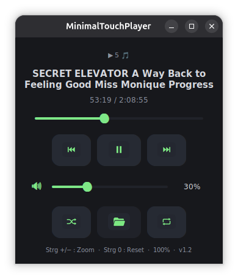
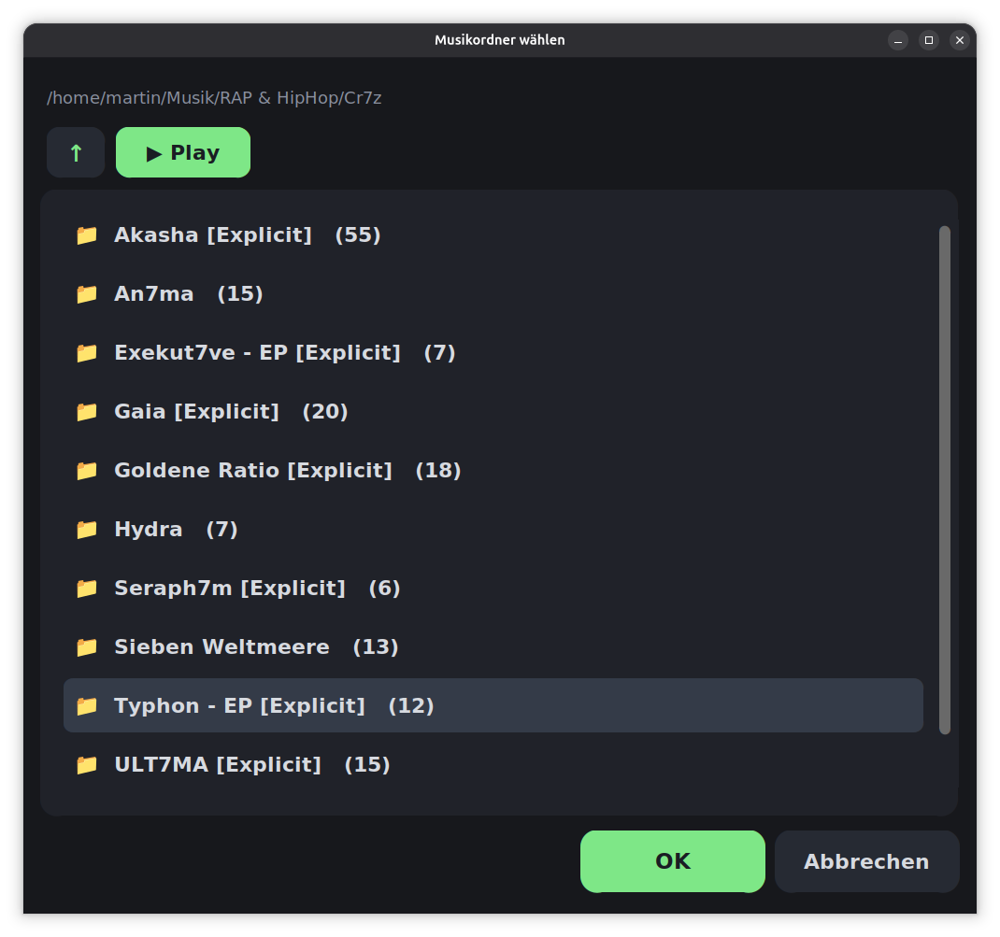

# MinimalTouchPlayer (MTP)

A minimalist, **square** desktop music player designed for small touch monitors (10", 1920×1280). Large PNG-icon buttons, dark theme, no album art — built to fit into tight desktop corners without wasting space. Zero clutter: just press play.

## Screenshots

| Main View | Folder Picker | Track Dropdown |
|-----------|---------------|----------------|
|  |  | |

> v1.2 ships with large, high-contrast PNG icons (512×400 RGBA) for effortless touch operation.

## Features

- 🎵 **Multi-format playback** — MP3, FLAC, OGG, Opus, M4A/AAC, WAV, WMA, AIFF, APE, WebM
- 📂 **Folder picker with track count** — browse and select a music folder; shows `(N)` tracks per subfolder (recursive scan, capped at 500)
- 🔊 **Live volume control** — real-time adjustment via slider or keyboard
- ⏯️ **Seamless pause/resume** — no restart, no audio gap
- 🔁 **Auto-next track** — automatically continues to the next song (respects shuffle & repeat)
- 🔀 **Shuffle mode** — toggle random playback order (key `s`), persisted across sessions
- 🔂 **Repeat modes** — Off → All → One cycle (key `r`): loop playlist or single track
- 📋 **Track dropdown** — tap the title bar to open a scrollable list of all tracks; select any song to jump directly
- 🔢 **Natural sort** — filenames with numbers sort correctly (Track 2 < Track 3 < … < Track 10)
- 💾 **Position resume** — remembers your last track and position across sessions
- 🌐 **Bilingual UI** — automatically switches between English and German based on system locale
- 🔍 **Zoom support** — `Ctrl +` / `Ctrl −` to scale, `Ctrl 0` to reset

## Installation

### Dependencies

| Package | Source | Notes |
|---------|--------|-------|
| Python 3.10+ | `apt` / preinstalled | Runtime |
| **CustomTkinter** | **`pip install customtkinter`** | ⚠️ NOT in apt repos — must be installed via pip |
| NumPy | `sudo apt install python3-numpy` or `pip install numpy` | Audio processing |
| FFmpeg | `sudo apt install ffmpeg` | Audio decoding |
| ALSA / PipeWire | `sudo apt install alsa-utils` (or `pipewire-pulseaudio`) | System audio output |

> **Note:** CustomTkinter is the only dependency that cannot be installed via `apt`. It must be installed with `pip`. The `.deb` package does NOT bundle it.

### From .deb package (recommended)

```bash
# Prerequisites (one-time setup)
sudo apt install dpkg-dev ffmpeg alsa-utils python3-numpy
pip install customtkinter

# Build the package
./packaging/build-deb.sh

# Install
sudo dpkg -i packaging/mtp_1.2.0_all.deb

# Or via apt:
sudo apt install ./packaging/mtp_1.2.0_all.deb
```

The package installs the app to `/usr/share/mtp/`, a launcher at `/usr/bin/mtp`, and registers it in your application menu automatically. The launcher will warn you if any dependency is missing.

### From source (any Linux distro)

```bash
# Install all dependencies (adjust package manager for your distro)
sudo apt install python3 ffmpeg alsa-utils python3-numpy   # Debian/Ubuntu
# sudo dnf install python3 ffmpeg alsa-utils python3-numpy  # Fedora
# sudo pacman -S python ffmpeg alsa-lib numpy               # Arch

pip install customtkinter

# Run
./start.sh
# or directly:
python3 mtp.py
```

#### Optional: Add to your application menu

1. Copy `mtp.desktop` to `~/.local/share/applications/`
2. Replace `/PATH/TO/REPO` with your actual clone path (e.g., `~/projects/minimaltouchplayer`)
3. Run `update-desktop-database ~/.local/share/applications/`

Now "MinimalTouchPlayer" appears in your app launcher! 🎵

## Usage

| Action | Button / Key |
|--------|-------------|
| Play / Pause | Center button · **Space** |
| Previous track | Left button · **←** |
| Next track | Right button · **→** |
| Volume up / down | Slider · **↑ / ↓** |
| Seek position | Drag the seek bar |
| Open folder picker | Folder button · **o** |
| Toggle shuffle | Shuffle icon (green = on) · **s** |
| Cycle repeat mode | Repeat icon (off → all → one) · **r** |
| Select track from list | Tap the title text |
| Zoom in / out | — · **Ctrl + / Ctrl −** |
| Reset zoom | — · **Ctrl 0** |

Select a music folder and press play. Tracks are scanned recursively, played in natural sort order, and the player remembers where you left off.

## Configuration

Runtime settings (volume, last folder, zoom level, resume position, shuffle, repeat) are stored automatically in `~/.config/mtp/config.json`. The directory is created on first save. No manual configuration needed.

### Audio device override

If no sound is produced, force a specific audio backend:

```bash
MUSIKPLAYER_DEVICE=pipewire ./start.sh   # PipeWire
MUSIKPLAYER_DEVICE=alsa ./start.sh       # ALSA (aplay)
```

Or list available devices with `aplay -L`.

## Technical Details

| Component | Role |
|-----------|------|
| **CustomTkinter** | GUI framework (dark, modern widgets) |
| **ffmpeg** | Decodes any supported audio format to raw PCM (48 kHz / stereo / 16-bit), no `-re` flag — sink-paced timing |
| **NumPy** | Real-time volume scaling per 4096-byte chunk + 60 ms fade-in ramp |
| **paplay / aplay** | System audio output (PipeWire preferred, `--latency-msec=80`) |

Architecture: `ffmpeg` decodes immediately into a pipe → Python pump thread scales volume and feeds chunks to the system player. The sound card itself provides timing (back-pressure on the pipe) — no sleep loops, no drift, no jitter. Pause is implemented via a blocking condition variable — no process restart, exact position retention.

## Project Structure

```
├── mtp.py                  # Complete application v1.2 (GUI + audio engine)
├── MTP Icons/              # 10 PNG button icons (512×400 RGBA, transparent BG)
├── icon.png                # App icon (512×512)
├── start.sh                # Development launcher script
├── images/                 # Screenshots for this README
├── README.md               # This file
└── packaging/
    ├── build-deb.sh        # One-command .deb builder
    └── deb/                # Package source tree (DEBIAN/, usr/bin, usr/share/)
```

## Uninstalling

```bash
sudo dpkg -r mtp
# Removes: /usr/bin/mtp, /usr/share/applications/mtp.desktop,
#          /usr/share/icons/hicolor/128x128/apps/mtp.png,
#          /usr/share/mtp/

# User config (NOT removed by package uninstall):
rm -rf ~/.config/mtp/   # optional: removes saved volume, folder, resume position
```

## Changelog

### v1.2.0 (2026-10-30)
- **Track dropdown** — tap the title to open a scrollable track list with large 14 pt font; select any song instantly
- **Natural sort** — numeric filenames sort correctly (Track 2 < Track 3 < … < Track 10), case-insensitive
- **Folder picker shows track count** — each subfolder displays `(N)` or `(500+)` for quick overview
- **Icons +50 % larger** — all transport & mode buttons enlarged for easier touch targeting
- **Shuffle & Repeat** — toggle shuffle (key `s`), cycle repeat off/all/one (key `r`)
- **Engine rewrite** — removed `-re`, sink-paced timing via audio pipe, 60 ms fade-in, duration cache

### v1.1.0 (2026-10-24)
- Initial public release: CustomTkinter GUI, .deb packaging, bilingual UI, position resume

## License

[MIT](LICENSE) © 2026 Pirate85

---

*Built with ❤️ for touch-friendly desktop music listening.*  
*Developed by Pirate85 & Herbert (Local AI)*
